# UI revision proposal: Taxy

Status: **built** (2026-11-13; review fixes F1 and F2 on 2026-11-14). Kene chose UI-1 to UI-13 all (a), added
UI-14 (profile block, yes) and UI-15 (no username change, no). Sections 1 to 8 are the Step A proposal as
written; Section 9 is the build record.

Decisions ([decision log](../00_planning/decision_log.md)): UI-1 to UI-13 are **D-189**, UI-14 is **D-190** and UI-15 is **D-191**.

> This is a research and reference tool, not tax advice. Nothing below changes what an answer says.

## 1. What Kene asked for

1. A less congested opening page, with a sidebar section labelled "About" that holds the main information and
   the expanders, privacy details included.
2. Example questions as cards, one at a time, with previous and next arrows just above the question box.
   Clicking a card puts its text in the box; it is not sent.
3. A better logo, and the name "Taxy" on the front.
4. Light, dark or system theme.
5. Better colour and layout.

Fixed (not open to choice): the D-180 consent acknowledgement and check box above the question box (Ask
disabled until ticked, tick not stored); a short disclaimer line and one short privacy line on the main page;
answer-card text, the verbatim check and the fallback unchanged; personal-data screen, limits, one question at
a time, start-up check, sign-in hooks, "My questions" behaviour and `app/review.py` unchanged; nothing under
`python/`, `eval/` or `data/` changes; no external fonts, scripts, images or CDNs; all text in `app/copy.py`.

## 2. The page today

Local app, start-up check passed, no question sent. Desktop at 1400 px (light) and phone at 390 px.

| Desktop, light | Phone, first load |
|---|---|
| 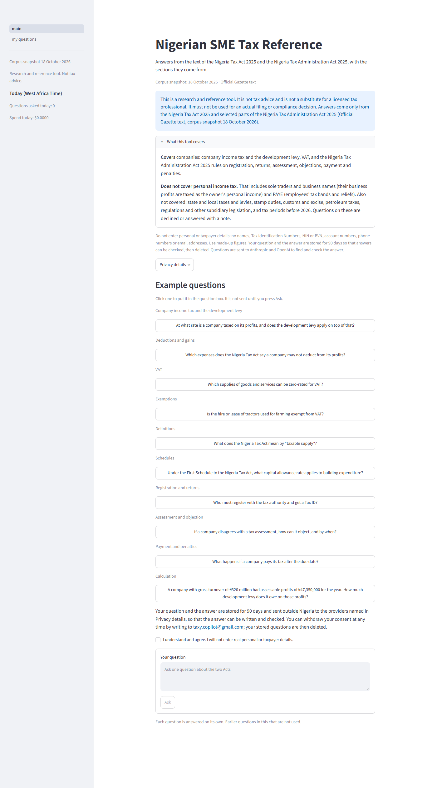 | 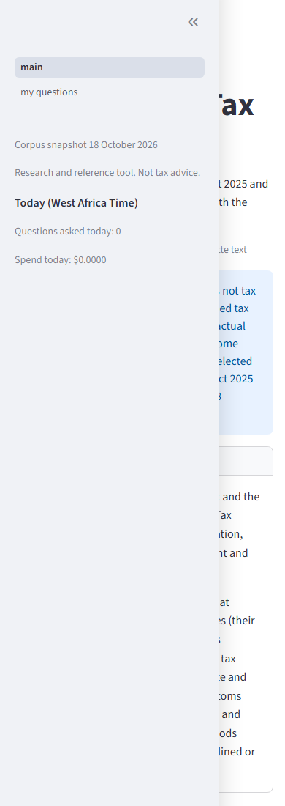 |

Findings:

- **F1 Long page.** The scope box opens on the first visit, then the long privacy line, then all ten example
  buttons. The question box is about 1,650 px down on a desktop and the phone page is 3,200 px long.
- **F2 Phone.** `initial_sidebar_state="expanded"` opens the sidebar over the whole page on a phone.
- **F3 Light-mode contrast fails WCAG AA.** Streamlit draws captions at 60% opacity. Measured: captions
  (privacy line, snapshot strip, example help) **3.70:1** on white; sidebar captions **3.54:1**; text-area
  placeholder 3.54:1. AA needs 4.5:1. Dark mode passes (captions 6.94:1).
- **F4 Page names.** The sidebar shows the file names "main" and "my questions".
- **F5 No theme choice.** `toolbarMode = "minimal"` hides Streamlit's menu, so the page follows the computer's
  setting and the reader cannot change it.

## 3. Theme: what Streamlit 1.66 gives

Checked on a second local instance (`--client.toolbarMode viewer` plus `[theme.light]` and `[theme.dark]`):

- With `[theme.light]` and `[theme.dark]` in `.streamlit/config.toml`, the "⋮" menu (top right) shows
  **System, Light, Dark**, then Print and Record screen, and the line "Made with Streamlit v1.66.0". No developer
  options (rerun, clear cache, deploy) appear in `viewer` mode, on localhost either.
- `toolbarMode = "minimal"` hides that menu completely (no `stMainMenu` element on the page). So the built-in
  switch needs `viewer`.
- Theme options cannot be set from the script (`st.set_option` rejects them), so an in-page theme switch would
  need custom JavaScript. Not proposed.
- The browser remembers the choice in its own local storage (`stActiveTheme-/-v2 = "Dark"`). Nothing is sent to
  the server; no cookie is added. The page already keeps one Streamlit key there (`stSidebarSectionsState-`).
- `gatherUsageStats = false` stays. Record screen uses the browser's own screen capture and saves a file
  locally; nothing is uploaded.

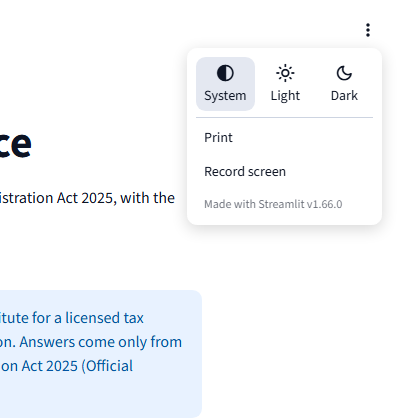

## 4. Proposed layout

**Main page, top to bottom** (first visit, no question asked yet):

1. **Title** "Taxy", then the subtitle "Nigerian SME Tax Reference", then the existing one-line tagline.
2. **Short disclaimer line**, one line with an info icon: "Research and reference tool. Not tax advice." plus
   the corpus snapshot date (UI-5).
3. **This session's questions and answers** (once there are any). Card text unchanged.
4. **Example card** (only before the first question, as now): one card with the topic and "3 of 10", the
   question as one full-width button, and a row with a back arrow, the counter and a forward arrow (UI-6).
5. **Privacy line** (short): "Do not enter personal or taxpayer details. Use made-up figures. Full privacy
   details are under About in the sidebar." plus the existing "Privacy details" button (UI-8).
6. **Consent** acknowledgement and check box, unchanged words, until ticked.
7. **Question box** and **Ask** (primary button), then the existing single-turn line.

**Sidebar, top to bottom:**

1. Logo (`st.logo`; the square icon shows in the header when the sidebar is closed).
2. Page links "Ask a question" and "My questions" with icons (UI-9).
3. **About** (heading), holding the moved texts, words unchanged:
   the snapshot strip; the full disclaimer; expander "What this tool covers" (scope text); expander "Privacy
   details" (the full privacy text).
4. **Today (West Africa Time)**: questions asked, questions left, spend (unchanged figures).
5. Signed-in line or the sign-in note (unchanged).

The sidebar starts closed on a phone and open on a desktop (UI-10). Everything is native Streamlit (config
theme, containers, buttons, badges, icons); no custom CSS, no HTML, no JavaScript.

## 5. Colour: two palettes

Both were applied through a theme file on a local instance and measured in the rendered page (headless Edge,
1400 px). Each probe takes the element's computed colour, multiplies in every ancestor's opacity, blends it
over the first opaque background behind it, then applies the WCAG 2.1 formula. Primary-button labels are not on
the first page, so those figures are computed (white on the primary colour); Step B measures them live. The
light text colour is darker than usual on purpose: it is what keeps 60%-opacity captions above 4.5:1.

| Palette A "Forest" (green) | Light | Dark |
|---|---|---|
| background / secondary / text | `#FFFFFF` / `#F1F5F2` / `#0B1510` | `#0F1613` / `#18231E` / `#E4EDE8` |
| primary / link / border | `#0A6B4B` / `#0A6B4B` / `#C9D6CF` | `#137A55` / `#6BCFA3` / `#2C3B34` |
| sidebar background | `#EDF3EF` | `#131D18` |
| body text | 18.60 | 15.36 |
| caption (privacy line) | 4.87 | 6.13 |
| sidebar caption | 4.69 | 5.95 |
| text-area placeholder | 4.72 | 5.74 |
| disclaimer (info box) | 14.10 | 6.93 |
| link | 6.53 | 9.68 |
| white label on primary button (computed) | 6.53 | 5.33 |

| Palette B "Ink and gold" (navy sidebar) | Light | Dark |
|---|---|---|
| background / secondary / text | `#FFFFFF` / `#F2F4F8` / `#0D1424` | `#0B111E` / `#151D30` / `#E3E8F2` |
| primary / link / border | `#1E4FA0` / `#1E4FA0` / `#CDD4E1` | `#2F62C0` / `#8EB3F4` / `#27324A` |
| sidebar background / sidebar accent | `#10213F` / `#F2C14E` | `#070C17` / `#F2C14E` |
| body text | 18.38 | 15.35 |
| caption (privacy line) | 4.82 | 6.04 |
| sidebar caption | 5.96 | 6.10 |
| text-area placeholder | 4.67 | 5.72 |
| disclaimer (info box) | 6.67 | 4.87 |
| link | 7.83 | 8.90 |
| white label on primary button (computed) | 7.83 | 5.79 |

All figures are contrast ratios (AA needs 4.5 for text). Shared settings in both: rounded corners `0.6rem`,
widget borders on, Streamlit's built-in font (no font setting; that it is served by the app itself, with no
outside download, is confirmed by the Step B network check).

| Palette A, light | Palette A, dark |
|---|---|
| 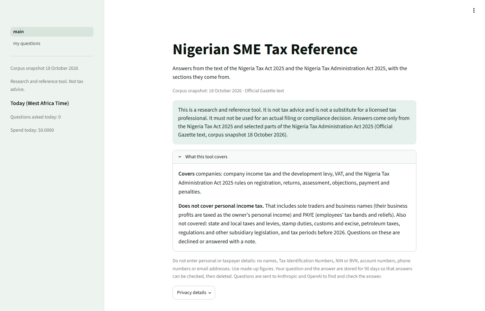 | 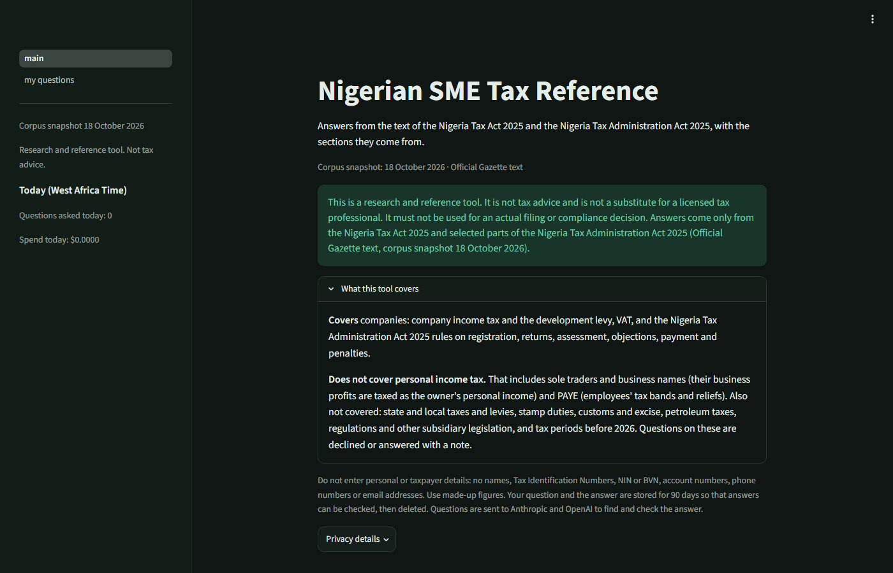 |
| **Palette B, light** | **Palette B, dark** |
| 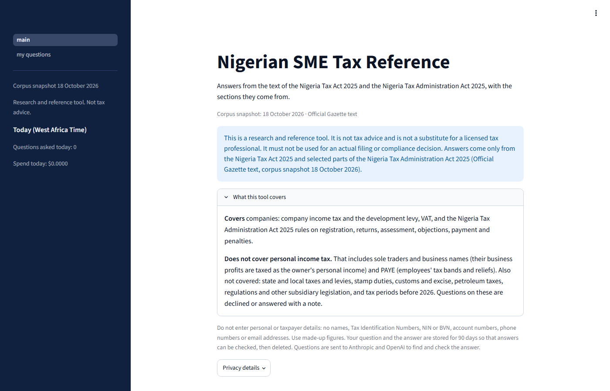 | 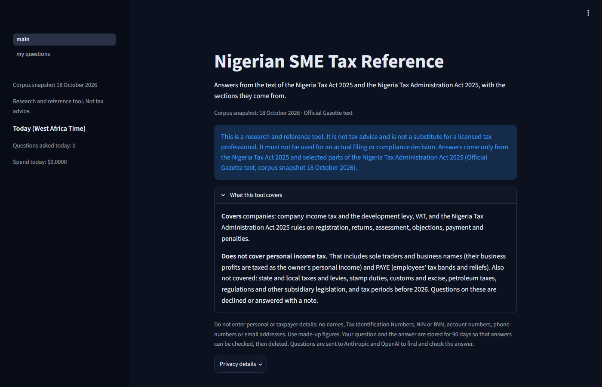 |

(These shots show the palettes on today's layout; the new layout comes in Step B.)

## 6. Logo: two drafts

Both are original SVGs drawn from simple shapes (strokes, a circle, rounded rectangles): no text elements, no
fonts, no embedded images, no links. Each has a square icon (page icon, collapsed header) and a wide badge with
the name for `st.logo`. The name sits on a filled badge, so it reads on light, dark and navy sidebars alike.

- **Draft 1 "Open Act".** A "T" whose crossbar is an open book, with a gold dot for a citation. In the badge
  the mark is the first letter of "Taxy".
- **Draft 2 "Cited answer".** A speech bubble with lines of text and a gold bookmark.

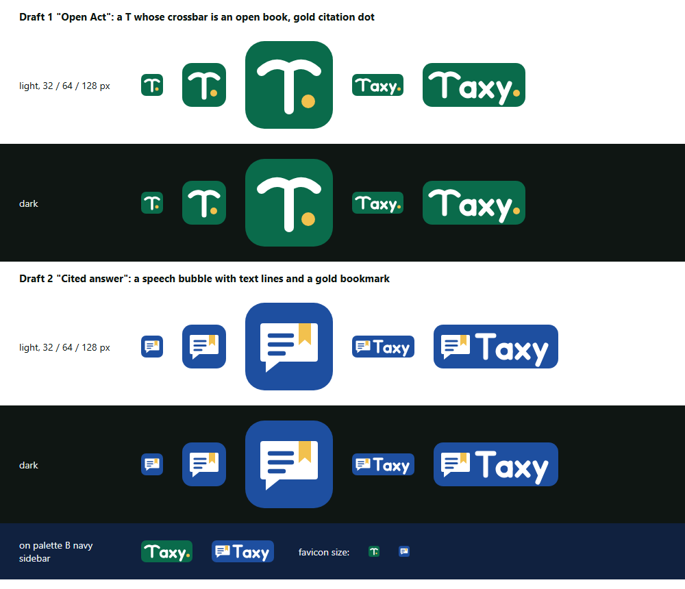

Either draft can take either palette's colour. The drafts live outside the repository until chosen; Step B adds
the chosen one as `app/assets/taxy_logo.svg` and `app/assets/taxy_icon.svg`.

## 7. Choices for Kene

| ID | Choice | Options | Recommendation |
|---|---|---|---|
| UI-1 | Name | (a) title "Taxy", subtitle "Nigerian SME Tax Reference", browser tab "Taxy · Nigerian SME Tax Reference", answer export heading unchanged; (b) one-line title "Taxy: Nigerian SME Tax Reference" | **(a)**: the name stands out and the subtitle says what it is |
| UI-2 | Palette | (a) A "Forest"; (b) B "Ink and gold" | **(a)**: calm and readable; long About text stays dark-on-light |
| UI-3 | Logo | (a) Draft 1 "Open Act"; (b) Draft 2 "Cited answer" | **(a)**: says "law text" and "Taxy" in one mark |
| UI-4 | Theme switch | (a) built-in menu: `[theme.light]` and `[theme.dark]`, `toolbarMode = "viewer"` (adds Print, Record screen, "Made with Streamlit"); (b) keep `minimal`: follows the computer, no choice | **(a)**: the only route without custom code |
| UI-5 | Disclaimer on the main page | (a) one short line (the existing "Research and reference tool. Not tax advice." with the snapshot date); the full disclaimer heads About and still ends every answer; (b) keep the full disclaimer box on the main page | **(a)**: meets the plan's "permanently visible" line and clears the top |
| UI-6 | Example card | (a) card with topic and "n of 10"; the question itself is the button; arrows and counter below it; wraps from 10 to 1; (b) the question as text plus a separate "Use this question" button | **(a)**: one click, as asked |
| UI-7 | Order above the box | (a) example card, privacy line, consent, question box; (b) consent, example card, question box | **(a)**: consent stays next to the Ask it unlocks |
| UI-8 | Privacy details on phones | (a) keep the small "Privacy details" button beside the short line (same text as About); (b) details only in About | **(a)**: the consent text names "Privacy details", and on a phone the sidebar starts closed |
| UI-9 | Sidebar page links | (a) hide the file-name links; add "Ask a question" and "My questions" with icons, shared by both pages (`my_questions.py` gets the shared sidebar call, logo and icon; behaviour unchanged); (b) leave "main" and "my questions" | **(a)** |
| UI-10 | Sidebar on phones | (a) `initial_sidebar_state="auto"`: closed on phones, open on desktops; (b) keep `expanded` | **(a)**: fixes F2 |
| UI-11 | Privacy text and the stored theme choice | (a) no wording change: the choice stays in the reader's browser and the app never receives it; (b) add one sentence to Privacy details and the README | **(a)**, noted in the decision log |
| UI-12 | README heading | (a) H1 "Taxy: Nigerian SME Tax Reference", the old "## Nigerian SME Tax Reference" heading removed; (b) keep the repository-name H1 and rename the H2 | **(a)**, as the task prompt says |
| UI-13 | Answer-card chrome | (a) Taxy icon as the answer avatar, a person icon for the question; Ask as the primary button; nothing inside the card changes; (b) leave the defaults | **(a)** |

Recommended set: all (a). Kene chose all (a): D-189. UI-14 (profile block) is D-190 and UI-15 (no username
change) is D-191.

## 8. Test changes needed in Step B

- `tests/test_app.py`
  - First render: title is "Taxy"; the subtitle, the short disclaimer line and the short privacy line are shown;
    the scope text, full disclaimer and privacy details are present (in About).
  - Examples: replace the ten-buttons test with one card. Forward visits all ten once and wraps, back goes the
    other way, clicking the card fills the box, nothing is sent and no audit row is written. The card is gone
    after the first question.
  - New: `.streamlit/config.toml` has `[theme.light]` and `[theme.dark]`, `toolbarMode = "viewer"`,
    `gatherUsageStats = false`, and no `http` (no font or theme URL).
  - New: a contrast guard that reads the theme colours from the config and checks body text, 60%-opacity
    captions on both backgrounds, links and white-on-primary at 4.5:1 or more, for both modes and the sidebars.
  - New: the logo SVGs exist and contain no `<script>`, `<image>`, `<text>`, `href` or `http` other than the SVG
    namespace.
  - Unchanged and still passing: consent tests, the personal-data screen, limits, answer cards, parity and
    fallback, "My questions", the copy rules (every new text goes in `app/copy.py`, no section sign, the
    disclaimer imported and never retyped).
- `tests/test_docs.py`: the README heading test changes for UI-12; the docs-index test adds this page.
- Baseline before the change: 1865 passed, 30 skipped. Step B reports the new counts against it.
- Step B also checks the network log of the running app: every request goes to `localhost` only.

## 9. Build (Step B, 2026-11-13)

Built: UI-1 to UI-13 option (a) (D-189), plus UI-14 (profile block, D-190). UI-15 (username change, D-191): not
built, the app stores no name (D-163). No answer-card text, parity check or fallback changed; nothing under `python/`, `eval/` or
`data/` changed; `app/review.py` unchanged. The build and its checks sent no question and made no paid call.

**Files**

| File | Change |
|---|---|
| `.streamlit/config.toml` | Palette A in `[theme.light]`, `[theme.dark]` and both sidebars; `toolbarMode = "viewer"`; `showSidebarNavigation = false`; `gatherUsageStats = false` kept |
| `app/assets/taxy_icon.svg`, `app/assets/taxy_logo.svg` | Logo draft 1 "Open Act" (plain shapes, no text, fonts, images or links) |
| `app/chrome.py` (new) | Page settings with the Taxy icon (`initial_sidebar_state="auto"`), `st.logo`, the two page links, the profile block and its delete dialog |
| `app/main.py` | Title "Taxy", subtitle, short disclaimer line, About in the sidebar, one example card with arrows, privacy line, consent, question box; Ask as the primary button; avatars |
| `app/pages/my_questions.py` | Uses `chrome.page_setup`, `chrome.nav_links` and `chrome.profile_block`; the page's own content and delete flow unchanged |
| `app/copy.py` | New texts (`APP_NAME`, `BROWSER_TITLE`, `SHORT_DISCLAIMER`, `DISCLAIMER_LINE`, `ABOUT_TITLE`, `NAV_ASK`, the example-card texts, `SIGN_IN_BUTTON`, `LOG_OUT_BUTTON`); the short `PRIVACY_LINE`; `EXAMPLES_HELP` reworded for the card; `SIDEBAR_SNAPSHOT` and `SIDEBAR_DISCLAIMER` replaced |
| `README.md` | H1 "Taxy: Nigerian SME Tax Reference"; the old "## Nigerian SME Tax Reference" heading removed (UI-12) |
| `tests/test_app.py`, `tests/test_docs.py` | See "Tests" below |

**Profile block (UI-14).** Last item of the sidebar, after a divider.

- **Signed in:** "Signed in as …" (the display text of this session only, as plain text: `st.text`, which is
  never parsed as Markdown), "Delete my history" and "Log out". My questions is not repeated here; it is already
  in the page links at the top of the sidebar (F2). Delete opens a dialog with the existing wording, then the same `erase_history` call
  and sign-out as My questions. Log out calls `services.extra["sign_out"]`, which Phase 11 wires to
  `st.logout()`; it is disabled until then.
- **Signed out, hosted:** "Sign in with Google". It calls `services.extra["sign_in"]`, for Phase 11 to wire to
  `st.login("google")`. Until then the button is disabled and the existing "switched on in a later phase" note
  shows under it.
- **Local, signed out:** not shown.

**Deviations**

1. **The profile block is not pinned to the bottom of the sidebar.** A key-class rule cannot place it there.
   Pinning needs CSS against Streamlit's internal sidebar containers and a background colour hard-coded for each
   mode, and a sticky block would cover About text on a phone. So the block is the last sidebar item, with no
   CSS (the fallback the task allowed).
2. **History tests open My questions through `AppTest.switch_page` from `app/main.py`,** as Streamlit runs a
   multipage app. With page links in the sidebar, running the page file on its own cannot resolve
   `main.py`. The tests' assertions are unchanged.
3. **The delete dialog stays open through a session flag.** "Delete my history" sets it; Cancel, closing the
   dialog and a finished delete clear it. This works the same in the browser and in AppTest.
4. **Fixed (F1, 2026-11-14): the signed-in line showed the email as a link.** Markdown auto-links email
   addresses, so the caption made the display text a `mailto:` link to the user's own address. The line is now
   `st.text`, which Streamlit never parses as Markdown, so the address is plain text. A test checks it.
5. **Ask's measured contrast is lower while it is disabled** (2.60 light, 3.40 dark). WCAG 1.4.3 exempts
   inactive controls. Enabled, it is 6.53 light and 5.33 dark.

**Checks on the running app** (local, start-up check passed, Edge headless at 1400 px and 390 px)

- Network: every resource the page loaded came from `http://localhost:8501` only (80 resources, one origin).
  Both fonts, Source Sans and Material Symbols, load from the app's own `/static/media/`.
- Page icon: the tab icon is the Taxy SVG (`data:image/svg+xml`, served inline by Streamlit). The logo is too.
- Theme: the "⋮" menu offers System, Light and Dark (Section 3). Telemetry is off.
- Rendered contrast (same probe as Section 5):

  | Element | Light | Dark |
  |---|---|---|
  | body text, title, checkbox | 18.60 | 15.36 |
  | caption (privacy line, help line) | 4.87 | 6.13 |
  | short disclaimer line (info box) | 14.10 | 6.93 |
  | link (consent email) | 6.53 | 9.68 |
  | secondary button label (example card) | 18.60 | 14.26 |
  | Ask, enabled (white on primary) | 6.53 | 5.33 |
  | text-area placeholder | 4.72 | 5.74 |
  | sidebar caption (About) | 4.69 | 5.95 |
  | sidebar expander label | 16.53 | 14.45 |

  Not measured: the yellow `st.warning` used by the delete dialog and the personal-data block. Both are
  Streamlit's default warning colours and are unchanged by this revision.
- Sidebar: Streamlit's own collapse control works ("«" closes it, "»" opens it) on desktop and phone. On a
  phone the sidebar starts closed and opens over the page.
- Signed-in and hosted profile shots were taken with a scratch launcher outside the repository. It wraps the
  real services with the tests' kind of fake identity. No question was sent and nothing was deleted.
  The signed-in and delete-dialog shots were retaken on 2026-11-14 after fixes F1 and F2.

| Desktop, light | Desktop, dark |
|---|---|
| 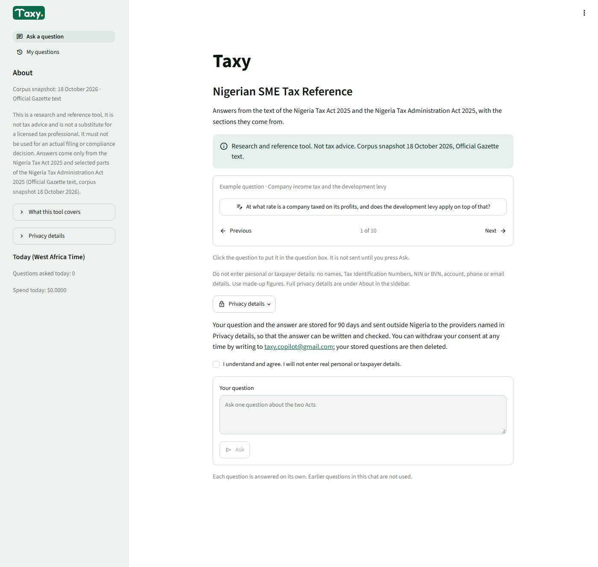 | 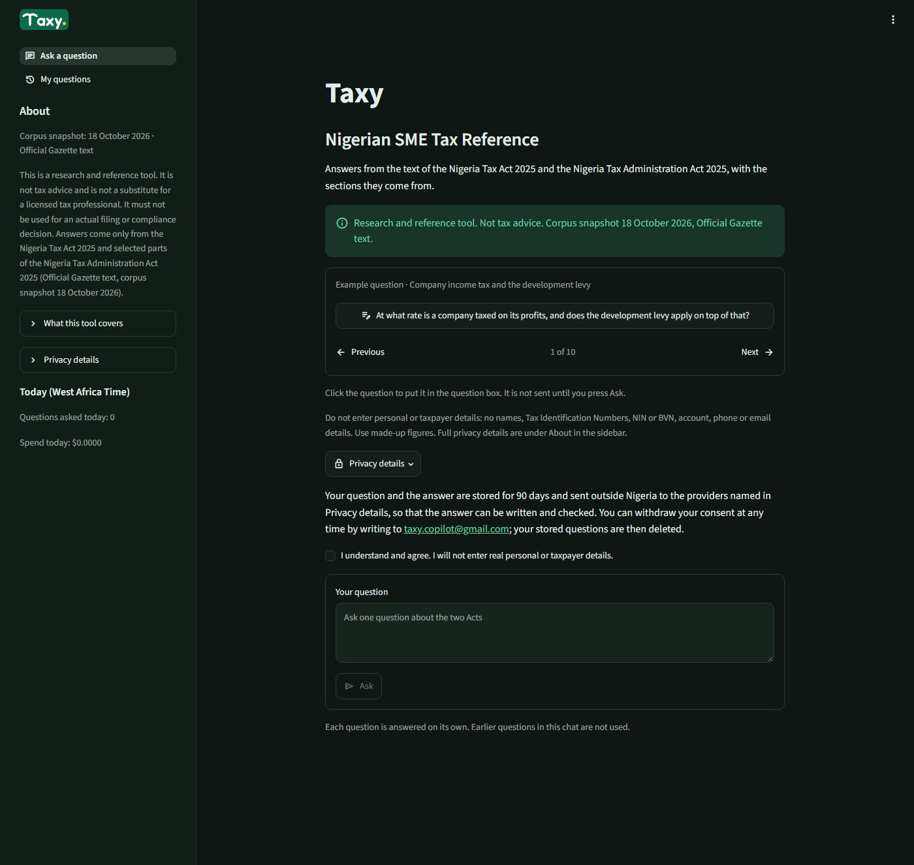 |
| **Desktop, sidebar closed** | **Phone, first load** |
| 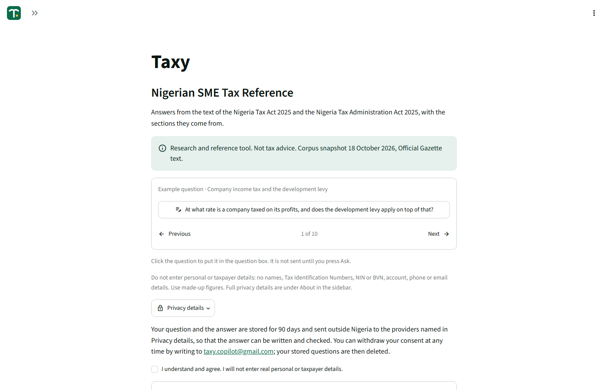 | 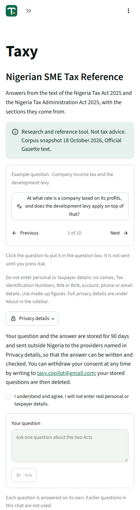 |
| **Phone, sidebar open** | **Profile, signed in (fake identity)** |
| 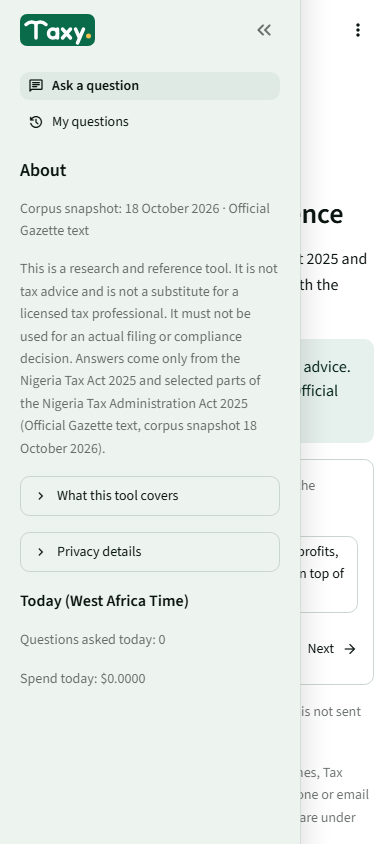 | 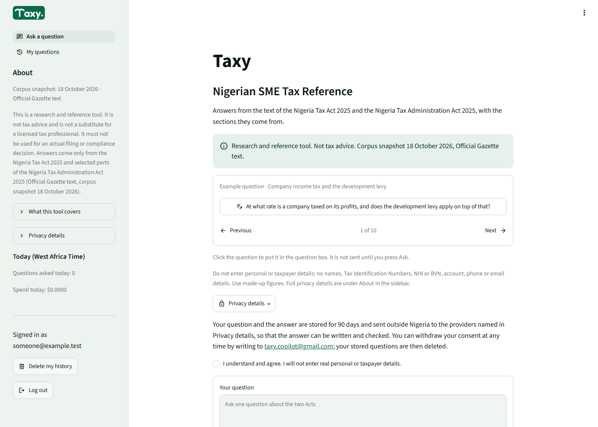 |
| **Profile, hosted, signed out** | **Delete my history dialog** |
| 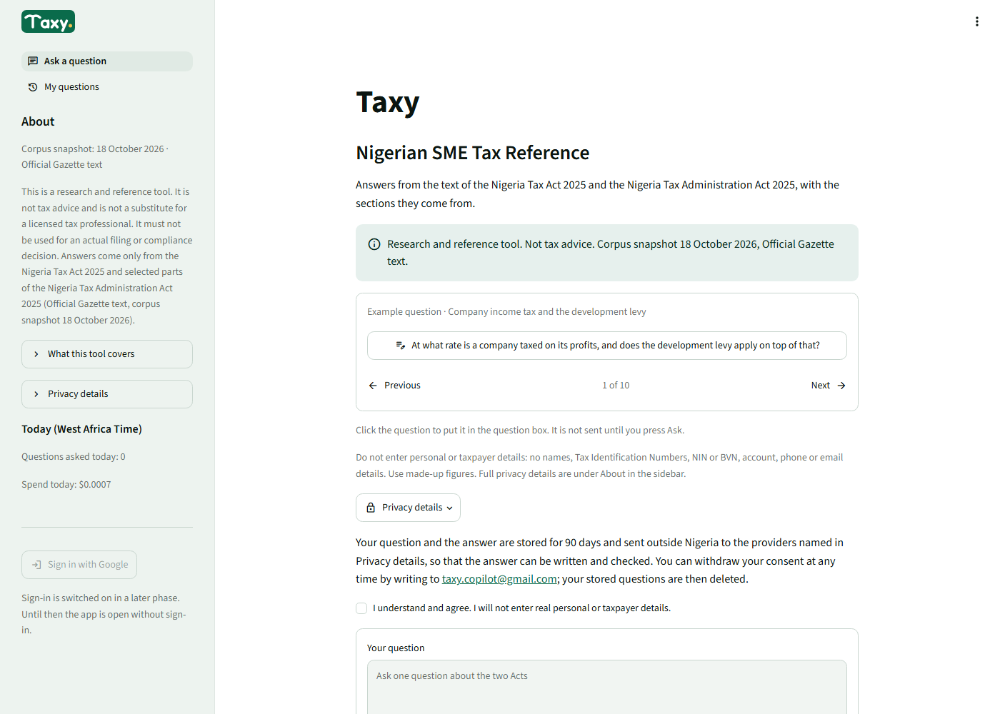 | 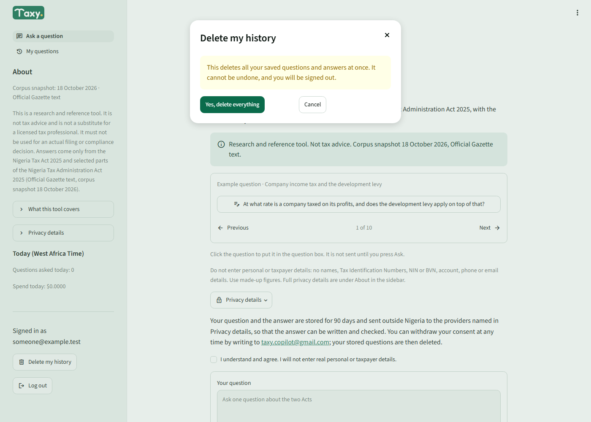 |

Page length before and after: desktop 2,521 px to 1,326 px; phone 3,222 px to about 1,400 px.

**Tests**

- `tests/test_app.py`:
  - **Changed:** first render (title "Taxy", subtitle, short disclaimer line on the main page, full disclaimer
    and scope text in About); the examples tests replaced for the single card; `new_app` opens other pages
    through `switch_page`; `make_services` takes a `deployment`.
  - **Changed in review (F1, F2):** the signed-in profile test reads the display from a text element and
    expects no page link in the profile block.
  - **New:** the card visits all ten questions and wraps both ways; clicking the card fills the box and sends
    nothing; the order of card, privacy line, consent and box; the page links on both pages; the profile
    hidden locally, the hosted sign-in disabled until the hook exists, and the hook then called; the signed-in
    profile on both pages, with Log out calling the hook and the display text written nowhere in the audit
    schema; delete from the profile (ask, cancel, confirm, only that user's rows, sign-out); the answer avatar
    and the primary Ask; the config (telemetry off, `viewer`, light and dark, no URL, no font setting); a WCAG AA
    guard on every theme colour pair for both modes; the logo files (plain shapes, nothing loaded from
    outside); both pages use `chrome.page_setup`; the signed-in email is a plain text element, never Markdown or
    a `mailto:` link (F1).
- `tests/test_docs.py`: the README heading test for UI-12, and the docs-index test now checks this page.
- Full suite (`.venv\Scripts\python -m pytest -q`, Docker database up): **1879 passed, 30 skipped** in 10 min 12 s,
  against 1865 passed and 30 skipped before. The 14 new tests account for the difference; nothing failed and
  the same 30 paid-API tests skip.

**For Phase 11.** `docs/phase11_deployment/deployment_design.md` Section 1.5 (a draft from another session)
still says `client.toolbarMode = "minimal"` is unchanged; it is now `"viewer"` (UI-4). The sign-in button reads
`services.extra["sign_in"]`; sign-out stays `services.extra["sign_out"]`.
