# Architecture

> This project is a research and reference tool, not tax advice.

The system has two parts: an offline corpus build that runs once per snapshot (2026-10-18), and the path
one question takes through the app. The diagram below is the same text as
[`diagrams/architecture.mmd`](../../diagrams/architecture.mmd), which is the source; GitHub renders it here.
Outside GitHub the block shows as Mermaid source text. Each node names the modules that do the work, and
`tests/test_docs.py` checks that the block equals the source file and that every named path exists.

```mermaid
flowchart TD
  subgraph BUILD["Corpus build: offline, deterministic, run once per snapshot"]
    direction TB
    B1["1 Raw sources: five PDFs pinned in data/manifest.csv<br/>python/ingest/fetch_raw.py<br/>python/ingest/verify_manifest.py"]
    B2["2 NTAA text: re-OCR of the NRS scan, aligned to the Gombe print<br/>python/ingest/ocr_ntaa.py<br/>python/ingest/align_ntaa.py<br/>data/curated/ntaa_nrs_proofread/"]
    B3["3 Text and structure: pdfplumber geometry split<br/>python/ingest/extract.py<br/>python/ingest/parse_structure.py<br/>python/ingest/scope.py<br/>python/ingest/tables.yml"]
    B4["4 Chunks and section map: 400 chunks, 450-token cap<br/>python/ingest/chunker.py<br/>python/ingest/section_map.py<br/>python/ingest/build_chunks.py"]
    B5["5 Discrepancy register: gazette against National Assembly text<br/>python/ingest/build_register.py<br/>data/curated/register_decisions.yml"]
    B6["6 Embedding and load: text-embedding-3-small, cache, pgvector<br/>python/embed/load.py<br/>python/embed/clients.py<br/>python/embed/schema.sql"]
    B1 --> B2 --> B3 --> B4 --> B5 --> B6
  end

  subgraph ASK["One question: the app"]
    direction TB
    Q7["7 Page and start-up check: fails closed unless configuration, corpus and audit schema match<br/>app/main.py<br/>python/interface/startup.py"]
    Q8["8 Personal-data screen, then admission with a receipt row before any paid call<br/>python/interface/screen.py<br/>python/interface/service.py<br/>python/interface/limits.py"]
    Q9["9 Pre-check: section and Schedule references, other Acts, foreign law, scope notes<br/>python/generation/guardrails.py (pre_check)<br/>note tagger alongside, Claude Haiku 5.5, three votes: python/generation/note_tagger.py"]
    Q10["10 Retrieval: vector top 5, exact section lookup, keyword slot, commencement, definition; then relevance floor<br/>python/retrieval/retrieve.py<br/>python/retrieval/references.py<br/>python/retrieval/commencement.py<br/>python/retrieval/definitions.py"]
    Q11["11 Generation: Claude Sonnet 5.5 writes claims citing passage labels, bounded tool loop<br/>python/generation/generate.py<br/>python/generation/prompt.py<br/>python/generation/llm.py<br/>tools: python/tools/lookup.py, python/tools/taxcalc.py, data/curated/calc_rates.yml"]
    Q12["12 Verification: rule check, Claude Haiku 5.5 claim verifier with evidence quotes, gap check<br/>python/generation/verify.py"]
    Q13["13 Disclosures for disputed text, and rendering with notes, sources and disclaimer<br/>python/generation/disclosure.py<br/>python/generation/generate.py (render)"]
    Q14["14 Audit: gen-log/3 record projected into the audit schema; card shown only if it equals the rendered text<br/>python/generation/audit_log.py<br/>python/audit/project.py<br/>python/audit/store.py<br/>app/cards.py"]
    Q15["15 Review, local only, never deployed: log viewer and CLIs on a read-only role<br/>app/review.py<br/>python/audit/report.py<br/>python/audit/show_query.py<br/>python/audit/compare_log.py"]
    Q7 --> Q8 --> Q9 --> Q10 --> Q11 --> Q12 --> Q13 --> Q14 --> Q15

    X8(["personal data blocked: nothing sent or stored"])
    X9(["pre-check refusals: no_such_section, section_outside_v1, foreign_law"])
    X10(["low_relevance refusal"])
    X11(["not_covered from the model"])
    X14(["error and withheld paths"])
    Q8 -.-> X8
    Q9 -.-> X9
    Q10 -.-> X10
    Q11 -.-> X11
    Q14 -.-> X14
  end

  B6 -->|"corpus_chunks, chunk_embeddings, corpus_loads"| Q7
  B6 -.->|"vectors for retrieval"| Q10
```

## Corpus build

1. Raw sources: five PDFs pinned by sha256 in `data/manifest.csv`; the large NRS scan is fetched and verified.
2. NTAA text: the NRS scan is re-read by OCR in its own environment and aligned to the Gombe print, with proofread sections.
3. Text and structure: pdfplumber splits each page by character geometry into header, body and margin notes.
4. Chunks and section map: 400 chunks under a 450-token cap, each with a context header; the build is byte-identical on every run.
5. Discrepancy register: differences between the gazette text and the National Assembly text, each with a recorded decision.
6. Embedding and load: `text-embedding-3-small` vectors, cached, loaded into the pgvector tables with a record of each load.

## One question

7. Page and start-up check: the app starts only if the shipped configuration, the corpus and the audit schema match what was measured.
8. Personal-data screen and admission: emails, phone numbers and long numbers are blocked; a receipt row is written before any paid call.
9. Pre-check: references to sections and Schedules, other Acts, foreign law and scope notes are handled before retrieval; a note tagger (Claude Haiku 5.5, three votes) runs alongside.
10. Retrieval: vector top 5 plus exact section lookup and a few attachments; a relevance floor refuses questions the corpus does not cover.
11. Generation: Claude Sonnet 5.5 writes claims that cite numbered passages, using a bounded loop with a section lookup and a calculator.
12. Verification: a rule check and the Claude Haiku 5.5 claim verifier check every claim against its cited text; unsupported claims are removed or moved to gaps.
13. Disclosures and rendering: disputed text is disclosed, and the answer is rendered with notes, sources and the disclaimer.
14. Audit: the generation record is projected into the audit schema, and the answer card is shown only if it equals the rendered text.
15. Review: a local log viewer and command-line tools read the audit log on a read-only role; they are never deployed.

Refusals leave the path early: personal data blocked (8), pre-check refusals (9), `low_relevance` (10), `not_covered` from the model (11), and the error and withheld paths (14).

See the [documentation index](../README.md) for the design document of each stage.
